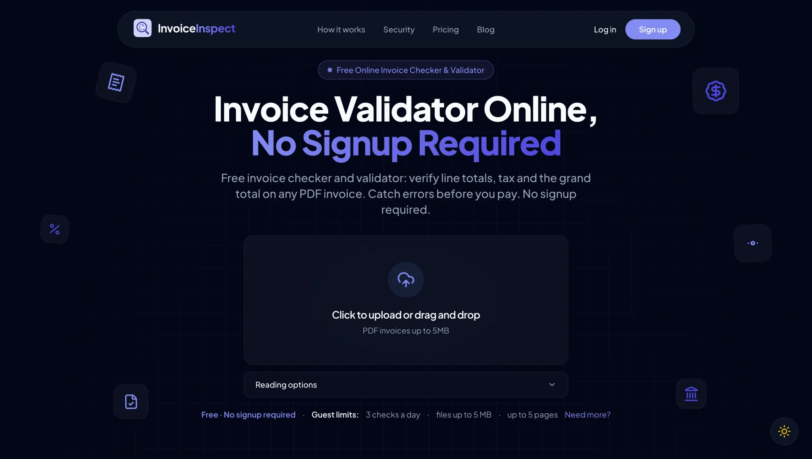

<div align="center">


**Before you pay an invoice, get a second opinion.**

Upload a PDF invoice and find out in seconds whether the line totals, tax and grand total actually add up, with the evidence to prove it. 

[**Try it live → invoiceinspect.app**](https://invoiceinspect.app) · [Portfolio case study](https://aliyanfaisal.com/products/invoiceinspect) · [Request source access](mailto:aliyanbarcha15@gmail.com?subject=InvoiceInspect%20private%20repo%20access)


<br>

<a href="https://invoiceinspect.app">
  
</a>

</div>

---

> **This is a showcase repository.** The full source code lives in a private repository. The product is live and free to use with no signup, and I'm happy to give access to the source on request: [email me](mailto:aliyanbarcha15@gmail.com?subject=InvoiceInspect%20private%20repo%20access).

## What it does

InvoiceInspect is an invoice validator for finance teams, accounts payable, freelancers and business owners. It reads a vendor invoice, rebuilds every number from scratch and flags anything that doesn't reconcile **before** money leaves the account.

- **Line items:** quantity × unit price checked against every line total.
- **Subtotal and grand total:** line sums, discounts, shipping and tax reconciled against the printed totals.
- **VAT / GST / sales tax:** rates compared with the tax amounts actually charged, and tax IDs checked for presence.
- **Duplicate charges:** repeated line items and double-billed amounts surfaced for review.
- **Missing fields:** invoice number, dates and other required details called out.
- **Evidence, not just a verdict:** each finding shows *Expected* vs *Invoice says* vs *Difference*, tied back to the page it came from.

## Why it's trustworthy

The core idea is simple: **money math should never be guessed by a language model.**

| Layer | Job | Approach |
| --- | --- | --- |
| **Extraction** | Turn a PDF into structured fields | Two independent readers: **native text + OCR** (smalot/pdfparser, Ghostscript, Tesseract) and an **AI vision model** that reads the rendered pages and quotes what it sees |
| **Verification** | Decide if the numbers are right | **Deterministic rules engine**: plain arithmetic, no AI in the verdict |
| **Reasoning** | Explain findings in plain English | LLM layer that explains and double-checks, but never overrides the math |
| **Review** | Handle unreadable numbers | When a value can't be read with confidence, the user picks the correct one and the checks re-run |

## Highlights

- **Rules-based verification engine** with independent rules for line totals, subtotals, grand total, tax, expected rates, required fields and duplicate charges.
- **Dual-path PDF reading:** native text extraction for digital PDFs, Ghostscript + Tesseract OCR for scans, with a visible *scan reading quality* indicator.
- **AI vision extraction:** a vision model reads the page images and must quote the exact printed text for every value. It never calculates or infers.
- **Cross-checking:** the AI read and the rules-based read are compared field by field, so a misread on either side is caught instead of trusted.
- **Downloadable PDF report** of the results for sharing with a vendor or an approver.
- **Evaluation harness with published results:** invoice generators and a scorer measure extraction and finding accuracy against known answers. The test invoices, answer keys, raw results and every test report are public, including the weak results (see [Accuracy and testing](#accuracy-and-testing)).
- **Provider-agnostic AI layer** with fallback between providers.
- **Plans and limits:** guest, free and paid tiers with per-day and per-minute limits, file-size and page caps.
- **Accounts and admin:** signup, login, email verification, password reset, and an admin dashboard for users, usage analytics, plans, SMTP settings and email logs.
- **Content and SEO:** blog system with Markdown rendering, guides, tax-specific landing pages (VAT, GST), sitemap and structured data.

## Accuracy and testing

InvoiceInspect is tested with an evaluation harness. It runs the checker on fictitious invoices whose correct values are known, compares what the checker found with those answers, and scores the result. Each invoice has an answer key that lists every field, every line item and the mistakes planted in it on purpose. The invoices, answer keys, raw results and every report are published on the [Harness Reports page](https://invoiceinspect.app/eval-harness-reports), and each invoice opens in a new tab from the [test invoices list](https://invoiceinspect.app/eval-harness-reports/invoices).

### Test reports

| Report | What it measured | Result |
| --- | --- | --- |
| [Test Report 1: Baseline](https://invoiceinspect.app/harness-reports/02-Test-Report-1-Baseline.pdf) | The extractor as it stood, on 30 independent and 40 generator invoices | Independent invoices: 84.5% field accuracy, 25 of 32 planted mistakes found, 30 false alarms. Generator invoices: 99.9%, 20 of 20, no false alarms. |
| [Test Report 2: After Fixes](https://invoiceinspect.app/harness-reports/03-Test-Report-2-After-Fixes.pdf) | The six reading problems from Report 1, fixed and scored again on the same invoices | Independent invoices: 98.1% field accuracy, 31 of 32 found, 6 false alarms. Generator invoices unchanged at 99.9%. |
| [Multi Page Invoice Testing and Issues Found](https://invoiceinspect.app/harness-reports/04-Multi-Page-Invoice-Testing-and-Issues-Found.pdf) | 40 new multi-page invoices the extractor had never seen | 72.2% field accuracy, 13 of 20 found, 50 false alarms. Lower accuracy is expected on invoices like these. |
| [Multi Page Invoice Fixes](https://invoiceinspect.app/harness-reports/05-Multi-Page-Invoice-Fixes.pdf) | The problems from the multi-page report, fixed and scored again on the same 40 invoices, plus the older sets scored again | Multi-page invoices: 99.98% field accuracy, 20 of 20 found, no false alarms. Independent invoices 99.1% and generator invoices 99.9% or better, so nothing got worse. The fixes were made on these invoices, so this shows the problems are gone, not how other invoices read. |

How the scoring works is explained in the [Evaluation Harness Guide](https://invoiceinspect.app/harness-reports/01-Evaluation-Harness-Guide.pdf), and the design and baseline results are written up in the [Research Report](https://invoiceinspect.app/research/InvoiceInspect-Research-Report.pdf).

### Test invoices

| Set | Invoices | What it holds |
| --- | --- | --- |
| **Corpus A: independent** | 30 | Written separately from the extractor with different PDF software: 10 page structures, 8 currencies, 4 languages, several tax types. 15 correct, 15 with one to three planted mistakes. |
| **Corpus B: built-in generator** | 40 | The project's own generator in 10 visual designs, half correct and half with one planted mistake. The easier set. |
| **Corpus C: multi-page** | 40 | 40 invoices with 40 answer keys. Of these, 9 run to two pages, 21 to three and 10 to four, and 20 carry a planted mistake. Wrapped descriptions, section totals, carried-forward rows, deposits, ship-to addresses and bank details, in five currencies including the Swiss number format. |

### Four extractors

| Name | What it does |
| --- | --- |
| `rules` | The real extractor: reads the PDF text and finds each field by pattern, position and arithmetic. |
| `rules-ocr` | The same extractor, run on a scanned picture of the page read by OCR software. |
| `oracle` | Test only. Ignores the PDF and returns the answer key, so it must score 100%. It shows whether the checking rules or the answer keys have a fault. |
| `broken` | Test only. Returns the answer key with about 30% of invoices damaged on purpose, so it must score badly. It shows the harness notices mistakes. |

### What the results show

- **The checking rules are correct.** With perfect input (the oracle) the rule engine found every planted mistake with no false alarms on all three sets: 32 of 32, 20 of 20 and 20 of 20.
- **Reading is the hard part.** Accuracy depends on page layout, and the extractor does much better on layouts it was built beside than on independent ones.
- **Fixing the reading problems works.** On the independent invoices field accuracy rose from 84.5% to 98.1% and false alarms fell from 30 to 6. That score was tuned on the same invoices, so Report 3 uses a fresh set.
- **Multi-page invoices expose new problems.** On the 40 new invoices the extractor scored 72.2%. All 10 Swiss-franc invoices score about 4%, because the Swiss number format (1'234.56) is not read, and the other 30 score 94.6%. The report also lists wrapped descriptions that are cut short, item codes joined to descriptions, section totals and deposit lines read as totals or discounts, and a few layout-specific misreads.
- **Results are published as they are.** Each report lists the problems found, and later reports score the same invoices again so that the effect of each improvement can be measured.

## Privacy by design

Free-tier uploads are **processed in memory and never stored**. There is no file persistence in the free flow. See the [Security page](https://invoiceinspect.app/security) for details.

## Tech stack

| Area | Tools |
| --- | --- |
| Backend | Laravel 13, PHP 8.3+ |
| Frontend | Blade, Tailwind CSS 4, Vite |
| Database | PostgreSQL |
| Admin panel | Filament 5 |
| AI | Anthropic Claude and OpenRouter (Qwen, Gemini Flash models) behind one provider interface with automatic fallback |
| Testing and quality | PHPUnit, Laravel Pint, custom evaluation harness |
| Deployment | GitHub Actions |

### PDF and OCR toolchain

| Step | Tool |
| --- | --- |
| Native text and layout extraction | [smalot/pdfparser](https://github.com/smalot/pdfparser) |
| Rendering PDF pages to images (for OCR and vision) | [Ghostscript](https://www.ghostscript.com/) (`gs`) |
| OCR for scanned invoices | [Tesseract OCR](https://github.com/tesseract-ocr/tesseract), multi-language capable |
| Vision extraction | Claude / OpenRouter vision models |
| Test invoice generation | [FPDF](http://www.fpdf.org/) for the built-in single-page and multi-page generators, [ReportLab](https://www.reportlab.com/opensource/) for the independently written invoice sets |
| Public test reports | [ReportLab](https://www.reportlab.com/opensource/), built from the saved run results |

### Main libraries

- [`laravel/framework`](https://laravel.com) for the application core
- [`filament/filament`](https://filamentphp.com) for the admin dashboard
- [`smalot/pdfparser`](https://github.com/smalot/pdfparser) for PDF text extraction
- [`league/commonmark`](https://commonmark.thephpleague.com) for the blog and landing-page Markdown
- [`symfony/yaml`](https://symfony.com/doc/current/components/yaml.html) for content front matter
- [`tailwindcss`](https://tailwindcss.com) and [`vite`](https://vite.dev) for the frontend build
- [`phpunit/phpunit`](https://phpunit.de) and [`laravel/pint`](https://laravel.com/docs/pint) for tests and code style

## Architecture at a glance

```text
PDF upload
   │
   ▼
PdfInspector ──► text layer (pdfparser) ─┐
   │                                     ├─► NormalizedDocument
   └──► Ghostscript → Tesseract OCR ─────┘
   │                                           │
   │                                           ▼
   └──► Ghostscript → page images        RulesExtractor
            └──► AI vision extraction ──► cross-check ◄──┘
                                   │
                                   ▼
                    Verifier ── deterministic rules
                    (line · subtotal · total · tax · rates · duplicates · required fields)
                                   │
                                   ▼
              Findings ──► AI explanation ──► Results page / PDF report
```

## Links

- **Live app:** [invoiceinspect.app](https://invoiceinspect.app)
- **Case study and details:** [aliyanfaisal.com/products/invoiceinspect](https://aliyanfaisal.com/products/invoiceinspect)
- **Source access:** [aliyanbarcha15@gmail.com](mailto:aliyanbarcha15@gmail.com?subject=InvoiceInspect%20private%20repo%20access)

## About the author

Built by **Aliyan Faisal**, a full-stack developer who builds products end to end, from the rules engine to the deployment pipeline. More of my work is on my [portfolio](https://aliyanfaisal.com).

Interested in the code, a similar build, or working together? Reach out at [aliyanbarcha15@gmail.com](mailto:aliyanbarcha15@gmail.com).

---

<sub>© Aliyan Faisal. All rights reserved. This repository contains documentation and screenshots only.</sub>
